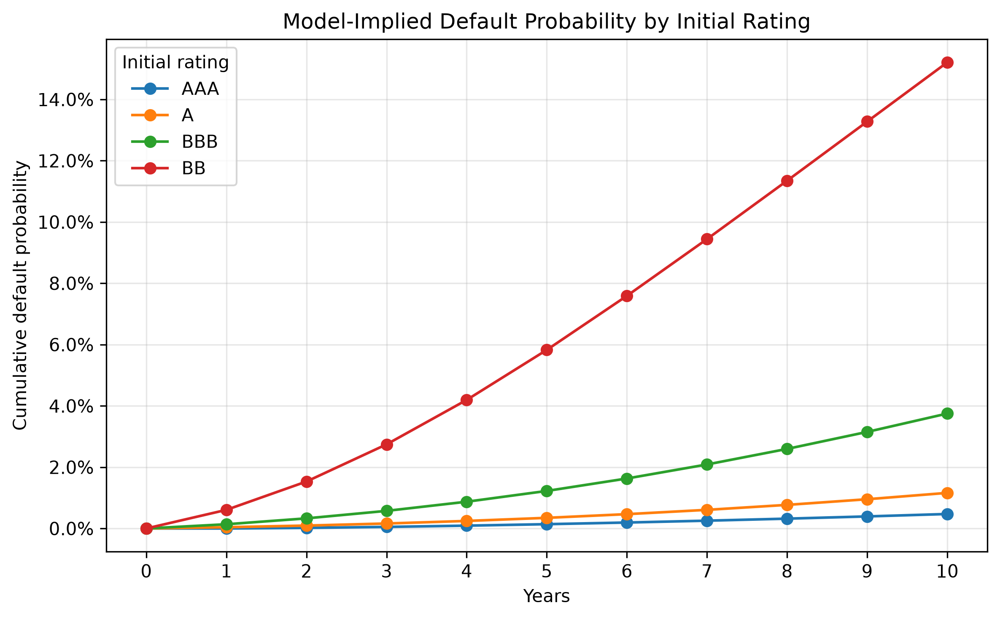
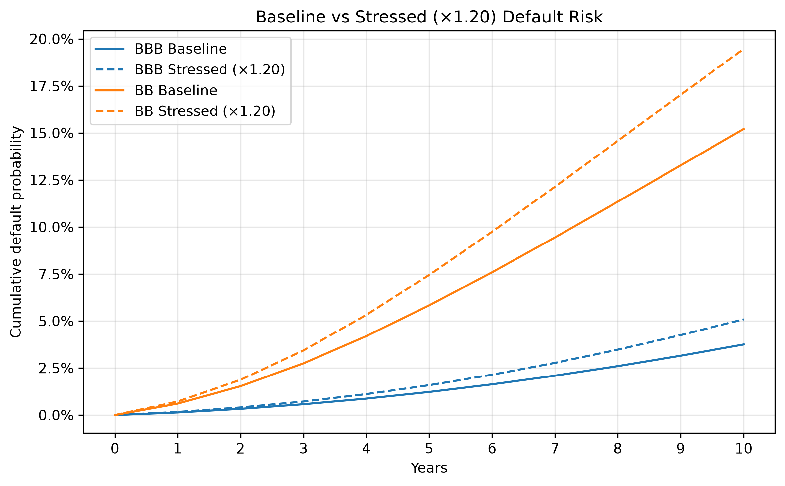
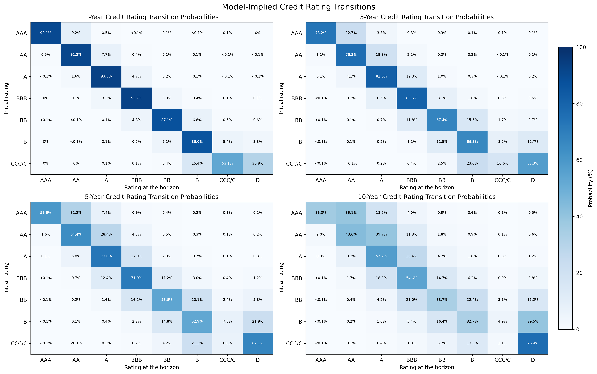
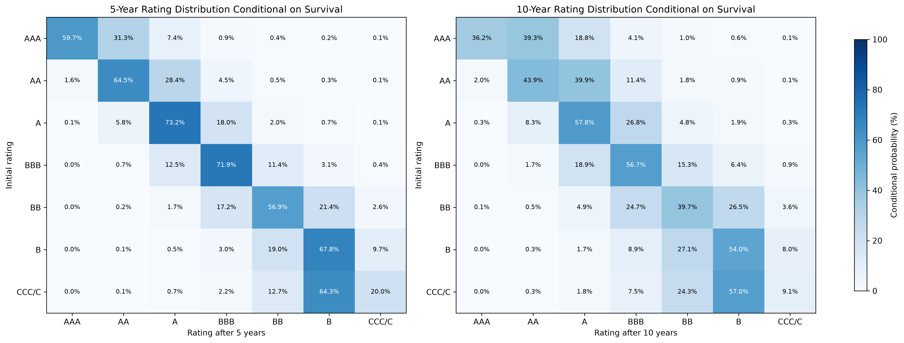

# Credit Rating Migration, Default Risk and Bond Valuation Using Markov Chains

**A Python study of credit-rating transitions, default risk, stress testing, and illustrative sterling bond values.**

This project uses a discrete-time, absorbing Markov chain to investigate how corporate credit ratings evolve and how changes in transition probabilities affect long-horizon default risk. It then connects rating outcomes to an illustrative sterling corporate-bond valuation using UK gilt yields and GBP credit-spread benchmarks.

## Main findings

The table below shows model-implied results for an issuer **initially rated BBB**. The temporary-stress scenario applies stressed transitions for the first two years, followed by the baseline matrix; persistent stress applies them throughout.

| Horizon | Scenario | Cumulative default probability | Expected terminal bond value* |
|---|---|---:|---:|
| 5 years | Baseline | 1.2251% | £85.64 |
| 5 years | Temporary stress (2 years, ×1.20) | 1.3699% | £85.46 |
| 5 years | Persistent stress (×1.20) | 1.5854% | £85.19 |
| 10 years | Baseline | 3.7502% | £91.31 |
| 10 years | Temporary stress (2 years, ×1.20) | 4.0113% | £91.12 |
| 10 years | Persistent stress (×1.20) | 5.0835% | £90.30 |

\* Expected values are **£ per £100 face value at the stated evaluation year**, not prices today. They exclude coupons received before that year, use a fixed September 2026 market snapshot, and depend on assumptions described below. Because remaining maturity differs, Year 5 and Year 10 value levels should not be interpreted as a realised investment return.

Under persistent stress, the BBB **10-year cumulative default probability increases by 1.3332 percentage points** relative to baseline. The corresponding expected terminal bond-value proxy decreases by about **£1.01 per £100 face value**. A temporary shock has a smaller, but still measurable, effect under the model.

## Visualisations

The script generates four figures in `figures/`.

**1. Cumulative default probability by starting rating** — Model-implied default probabilities over years 0–10 for AAA, A, BBB, and BB.



**2. Baseline versus persistent stress (×1.20)** — Compares the time profiles of BBB and BB default probabilities.



**3. Credit-rating transitions after 1, 3, 5, and 10 years** — Each heatmap shows all seven initially non-defaulted ratings against eight possible destinations, including default.



**4. Conditional rating distributions after 5 and 10 years** — Shows the rating mix **among issuers that have not defaulted** by the evaluation year.



## Data sources and modelling inputs

| Input | Value / coverage | Source or status |
|---|---|---|
| Annual corporate rating transitions | 1981–2025 average global corporate transition matrix | [S&P Global Ratings, *2025 Annual Global Corporate Default and Rating Transition Study*](https://www.spglobal.com/ratings/en/regulatory/article/default-transition-and-recovery-2025-annual-global-corporate-default-and-rating-transition-study-s101673333) |
| UK nominal gilt par yield, 5 years | **4.922%**, 30 September 2026 | [Bank of England daily yield data](https://www.bankofengland.co.uk/boeapps/database/), series `IUDSNPY` (4.9224% before rounding) |
| UK nominal gilt par yield, 10 years | **5.371%**, 30 September 2026 | [Bank of England daily yield data](https://www.bankofengland.co.uk/boeapps/database/), series `IUDMNPY` (5.3714% before rounding) |
| GBP investment-grade corporate index OAS | **85.72 basis points (0.8572%)**, 30 September 2026 | [MSCI GBP Investment Grade Corporate Bond Index](https://www.msci.com/indexes/index/734508/msci-gbp-investment-grade-corporate-bond-index) |
| GBP high-yield corporate index OAS | **464.95 basis points (4.6495%)**, 30 September 2026 | [MSCI GBP High Yield Corporate Bond Index](https://www.msci.com/indexes/index/734509/msci-gbp-high-yield-corporate-bond-index) |

The Bank of England figures are stored in the code rounded to three decimal places, as recorded from a previous database download. All valuation inputs are **fixed to the 30 September 2026 snapshot**; they are not projected future gilt yields or spreads.

**Observed versus estimated:** The two MSCI values are published **broad-market index OAS measures**. The separate seven-rating GBP spreads used later are **model-derived proxies**, not independently observed market quotations. The underlying S&P transition data and market index observations belong to their respective providers; consult their reuse terms before redistributing source datasets.

## Mathematical framework

### 1. Transition matrix

Let $X_n$ be an issuer's credit rating at the end of year $n$. The model has eight states:

$$
\mathcal{S}=\lbrace AAA,AA,A,BBB,BB,B,CCC/C,D \rbrace.
$$

The initial S&P table also includes `NR` (Not Rated). The program removes the `NR` destination, **renormalises each remaining row by its actual sum**, and adds a default row with $P_{DD}=1$. Consequently, default is absorbing and the model conditions each annual transition on not entering `NR`.

The resulting $8\times8$ stochastic matrix is $P$. The $n$-year transition probabilities are

$$\Pr(X_n=j\mid X_0=i)=(P^n)_{ij}.$$

In Python, **matrix exponentiation** is computed using `np.linalg.matrix_power(P, n)` (not `P**n`, which performs elementwise exponentiation in NumPy).

This construction assumes a **first-order, time-homogeneous Markov chain**: the next rating depends on the current rating alone, and the baseline transition matrix stays constant through time.

### 2. Default, survival, and absorption

Partition the transition matrix as

```math
P = \begin{pmatrix}
Q & R \\
0 & 1
\end{pmatrix}
```

where $Q$ contains transitions among seven non-default ratings and $R$ contains one-year transitions from those ratings to default. With $\mathbf 1$ denoting a vector of ones:

| Quantity | Formula | Interpretation |
|---|---|---|
| Survival through year $n$ | $S_i(n)=(Q^n\mathbf 1)_i$ | Not defaulted by year $n$ |
| Cumulative default by year $n$ | $F_i(n)=1-S_i(n)$ | Defaulted by or during year $n$ |
| First default during year $n$ | $f_i(n)=(Q^{n-1}R)_i$ | First absorption into `D` in year $n$ |
| Conditional hazard in year $n$ | $h_i(n)=f_i(n)/S_i(n-1)$ | Default during year $n$, given survival to its start |
| Survivor rating mix | $\pi_{ij}(n)=(Q^n)_{ij}/S_i(n)$ | Probability of surviving in rating $j$, conditional on survival |

The fundamental matrix is

$$
N=(I-Q)^{-1}=\sum_{k=0}^{\infty}Q^k.
$$

Its entry $N_{ij}$ represents the expected number of visits to rating $j$ before default, starting from rating $i$, including time zero.

The expected time to default is

$$
t=N\mathbf{1}.
$$

Here, $t_i$ is the expected time to default starting from rating $i$.

The second moment of the time to default is

$$
m_2=(2N-I)t.
$$

Here, $(m_2)_i$ is the second moment of the time to default starting from rating $i$.

The standard deviation of the time to default for each initial rating $i$ is

$$
\sigma_i=\sqrt{(m_2)_i-t_i^2}.
$$

The script also calculates the model-implied median time to default, defined as the first year for which $F_i(n)\geq 0.5$, and the eventual absorption probabilities.

These long model-implied default times are consequences of the absorbing Markov-chain assumptions and should not be interpreted as predictions of actual company lifetimes.

## Stress testing

To construct $P_{\mathrm{stressed}}$, the model multiplies each **downgrade/default transition weight** by the factor **×1.20**, then renormalises the row. Upgrade and unchanged-rating weights are not multiplied; `D` remains absorbing. Renormalisation ensures probabilities sum to one, so the *final* downgrade/default probabilities do not necessarily increase by exactly 20%.

The program compares three scenarios for $n=5$ and $n=10$:

| Scenario | Transition matrix product | Interpretation |
|---|---|---|
| **Baseline** | $P^n$ | Historical-average mechanism applied throughout |
| **Temporary stress** | $P_{\mathrm{stressed}}^2P^{n-2}$ | First two years stressed, then baseline |
| **Persistent stress** | $P_{\mathrm{stressed}}^n$ | Stressed mechanism applied throughout |

The ordering matters: rating distributions are row vectors, so the two-year recession is applied **before** the remaining baseline years. All seven non-default starting ratings are reported, including percentage-point changes relative to baseline. These scenarios are deliberately hypothetical; the ×1.20 factor is **not a calibrated historical recession parameter**.

## Sterling Bond Valuation

The bond example translates credit-rating outcomes into an illustrative **expected terminal value**, rather than attempting to price a specific traded bond.

### Bond assumptions

| Assumption | Value |
|---|---:|
| Face value | £100 |
| Original maturity | 15 years |
| Annual coupon | 5% of face value (£5) |
| Assumed default-state recovery value | £40 (40% of face value) |
| Remaining maturity at Year 5 / Year 10 | 10 / 5 years |
| Market-input snapshot | 30 September 2026 |

### Rating-specific GBP spread estimates

Because the public benchmark inputs provide only investment-grade and high-yield index spreads, the model estimates seven separate spread proxies as follows:

1. Use the baseline Markov-model **10-year default probability** $F_i(10)$ for each rating.
2. Convert it into a constant annual default-intensity proxy: $\lambda_i=-\ln(1-F_i(10))/10$.
3. Define an **assumed** concave credit-risk score $q_i=\sqrt{\lambda_i}$.
4. Within each rating group, scale the scores so their **simple arithmetic mean** equals the observed index OAS:

$$s_i=\bar s_B\frac{q_i}{\frac{1}{|B|}\sum_{j\in B}q_j},$$

where $\bar s_B$ is the relevant MSCI index OAS and the groups are $B_{IG}=\{AAA,AA,A,BBB\}$ and $B_{HY}=\{BB,B,CCC/C\}$.

The resulting estimates, rounded to three decimal places, are:

| Rating | AAA | AA | A | BBB | BB | B | CCC/C |
|---|---:|---:|---:|---:|---:|---:|---:|
| **Estimated GBP spread** | 0.522% | 0.606% | 0.819% | 1.482% | 2.446% | 4.268% | 7.235% |

**These are synthetic values.** The square-root mapping, ten-year default horizon, and **equal-weight calibration** are explicit assumptions. Published MSCI index OAS figures reflect actual index composition and are not reproduced by this equal-weight exercise.

### Expected terminal value

For a surviving rating $j$ and remaining maturity $m$, the project assumes a constant required yield

$$y_j=r_{\mathrm{gilt}}(m)+s_j.$$

A hypothetical bond with a £5 annual coupon then has rating-dependent terminal value proxy

$$V_j(m)=\sum_{u=1}^{m}\frac{5}{(1+y_j)^u}+\frac{100}{(1+y_j)^m},$$

with $V_D=40$. Combining the value vector with a scenario transition matrix gives

$$\mathbb E[V(X_n)\mid X_0=i]=(P_{\mathrm{scenario}}V)_i.$$

The script compares these expected values for **all seven initial ratings**, at Years 5 and 10, under baseline, temporary, and persistent stress. The probabilities change between scenarios, while the gilt yields and rating-spread estimates are **held fixed**.

## Limitations and interpretation

1. **Markov and time-homogeneity assumptions:** Credit ratings alone do not fully describe an issuer's financial position, rating history, industry or economic environment. Constant annual baseline transitions are a simplification.
2. **Withdrawn ratings (`NR`):** Removing `NR` and renormalising conditions each step on remaining in the modelled rating/default system. Withdrawals may not occur randomly and this choice can affect long-horizon risk estimates.
3. **Stress scenarios:** The ×1.20 downgrade-weight multiplier and two-year recession duration are illustrative rather than empirically calibrated. Real recessions can also affect the level of credit spreads and interest rates.
4. **Spread calibration:** The seven GBP spreads are derived partly from the model's own defaults and anchored only to two broad MSCI indices. They are not seven observed rating-specific market quotes, and the calibration is not an independent validation of the default model.
5. **Bond valuation:** Index option-adjusted spreads plus nominal gilt *par* yields provide a single-yield approximation, not a full term structure or issuer-specific valuation. Earlier coupons, interim defaults, recovery timing, taxes, liquidity and other contract features are omitted. In particular, the **Year 5 and Year 10 numbers are not present values today or directly comparable total returns**.
6. **Data populations and pricing measure:** S&P's transition matrix covers global historical corporate issuers, whereas the bond inputs describe GBP markets at a single date. Historical default frequencies are not risk-neutral probabilities; the resulting weighted values are **scenario proxies**, not arbitrage-free market prices.
